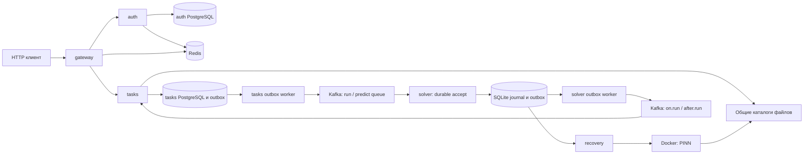

# Архитектура: фактическое состояние

Основа — PR #16; путь solver обновлён 23 октября 2026 года. «Работает в runtime» означает
подключение в исходном коде, а не подтверждение запуском всего окружения.

## Сервисы и владение данными

В `go.work` пять модулей: общий `pkg` и четыре сервиса. Каждый `cmd/main.go`
собирает зависимости явно. Общий пакет предоставляет технические механизмы;
`internal` сервиса содержит его domain и бизнес-сценарии.

| Часть | Ответственность | Данные и внешние зависимости |
| --- | --- | --- |
| gateway | Проверка access token/сессии, audit context, проксирование HTTP | JWT, Redis через L1 cache, Kafka для compromised session |
| auth | Пользователи, роли, login/refresh/logout | Собственный PostgreSQL, Redis-сессии, consumer compromised session |
| tasks | Загрузка файлов, метаданные, запрос запуска, состояния и выдача результатов | Собственный PostgreSQL, tasks outbox, Kafka, каталоги данных и результатов |
| solver | Выполнение команды train/retrain/predict через Docker | Kafka, Docker API, те же файлы на Docker-host; SQLite journal и outbox |
| pkg | HTTP, Kafka, SQL-клиенты, кеш, lifecycle и служебные проверки | Не владеет бизнес-операциями сервисов |

PostgreSQL auth/tasks уже обслуживает их бизнес-данные. SQLite предложена для
локального журнала solver: небольшой объём метаданных и один Docker-host пока
не требуют ещё одного серверного хранилища. Это разные задачи хранения.

## Основной поток

1. `tasks/create` принимает multipart, ограничивает весь body до разбора,
   проверяет набор файлов режима и создаёт задачу с каталогами. Запись файлов
   сейчас выполняется внутри транзакции PostgreSQL — это оставшееся ограничение.
2. `tasks/run` одной транзакцией записывает запрос идемпотентности пользователя,
   блокирует задачу, переводит `created → in_queue` и сохраняет событие outbox.
   Повтор того же ключа и task ID успешен; другой task ID с тем же ключом даёт
   конфликт. Новый ключ не разрешает повторно вычислить уже запущенную задачу.
3. `tasks/internal/outbox` выбирает события с `FOR UPDATE SKIP LOCKED`, публикует
   в Kafka и удаляет подтверждённые записи. Потеря подтверждения/commit допускает
   повтор с тем же ключом. Транзакция остаётся открытой во время Kafka I/O.
4. Solver принимает команды через `StrategyAtLeastOnce` и `tasks/accept` в SQLite.
   Recovery вызывает стадии попытки; события старта/завершения доставляет solver outbox.
   Lifecycle объединяет обе очереди и workers, затем закрывает зависимости.
5. Consumers tasks применяют события под блокировкой строки. `Task.MarkRunning`
   не возвращает завершённую задачу в running; `Task.Complete` принимает результат
   раньше события старта и сохраняет первый финальный исход.

Идемпотентность HTTP, доставка Kafka и однократность вычисления — три разные
гарантии. Исправление первой не доказывает остальные. `event_id` в принятом
запросе хранит стабильную идентичность команды после удаления outbox; это не FK
на временную очередь.

## Устойчивый путь solver

| Механизм | Код | Что ещё нужно |
| --- | --- | --- |
| Файловая SQLite, WAL/FULL, один владелец | `pkg/sqlite` | Runtime-конфигурация, открытие и закрытие журнала |
| Попытки и атомарное завершение с outbox | `solver/internal/adapter/sqlite` | Recovery, взаимодействие с Docker |
| Устойчивый приём команды | `solver/internal/usecases/v1/tasks/accept` | Подключение после готовности восстановления |
| Публикация сохранённых результатов | `solver/internal/usecases/v1/outbox`, `solver/internal/outbox` | Подключение worker под lifecycle |
| Детерминированное имя по run ID | `PinnRunner.containerName` | Используется новым путём попыток; старый Run имеет прежнее имя |

`AttemptAccepted`, `AttemptContainerCreated`, `AttemptStartRequested`,
`AttemptRunning`, `AttemptFinished` описывают стадии попытки исполнения.
Они не расширяют публичные статусы Task. Для `AttemptRunning` пока нет полного
runtime-перехода. Перед Start нужен сохранённый intent, а неоднозначный ответ
Docker требует Inspect, иначе повторный Start может повторить вычисление.

Общий SQLite-клиент принимает Squirrel-compatible `Sqlizer`, сканирует структуры
через существующий scany/sqlscan и привязывает транзакцию к конкретному клиенту
в контексте. Транзакции разных клиентов независимы: общей атомарности между
двумя файлами нет. Вложенная транзакция того же клиента отклоняется.

`Attempt` создаётся через `NewAttempt`, восстанавливается через `RestoreAttempt`
из непроверенного `AttemptSnapshot`. `RecordContainer`, `RequestStart` и `Finish`
проверяют переход до замены состояния. Репозиторий сохраняет результат метода
условным SQL UPDATE; commit failure возвращает ошибку, а не `Changed(true)`.
`Created` отличает новую регистрацию от успешного повтора. На первом запросе
используется INSERT RETURNING; повтор требует прочитать сохранённую команду и
сравнить параметры в той же транзакции. Unique violation сам по себе не различает
корректный повтор и конфликт параметров.

SQL-строки и Input не являются доменными сущностями. `eventRow/messageRow` отвечают
за преобразование в проверяемые `Event` и `core.KafkaMessage`. Последний владеет
правилами Kafka metadata и `IdKey`/`WithIdKey`; domain проверяет связь ID события
с идентичностью сообщения. `limit.Limit` хранит положительный SQL limit за закрытым
полем. Готовый Limit проверяется конструктором, а не каждым запросом заново.
Нулевое значение Go не считается успешно созданной сущностью.

Solver outbox отправляет порцию сообщений одним вызовом. Kafka-адаптер переводит
`kafka-go.WriteErrors` в ошибку с подтверждёнными позициями. Usecase удаляет одной
операцией только подтверждённые ID. Неизвестная ошибка оставляет batch для повтора;
неверные индексы внутреннего `kafka.PartialErr` означают ошибку программирования
и приводят к panic. Driver types в бизнес-логику не проходят.

Готовая сущность повторно не валидируется при передаче между слоями.
`RegisterAttempt` спрашивает `CanRegister`, не повторяет общий Validate.
`WithIdKey` принимает готовые message/key и возвращает только сообщение.
Схема и поля row описаны в `schema.go`, конструкторы row и преобразования —
в `converters.go`. Ошибка конструктора восстановления внутри toDomain означает
нарушение persistence-контракта и вызывает panic; штатные SQL I/O ошибки остаются
ошибками репозитория. Общие `Created`, `Changed` находятся в core и сохраняют тип
в Output; Kafka-специфичный `PartialErr` — в pkg/kafka, SQL RETURNING — в shared SQLite.

Общий `pkg/docker` скрывает Moby SDK за собственными DTO `Config`, `Container` и
`Exit`; предоставляет Create/Inspect/Start/Wait/Logs/Remove/Close. Известные ошибки
not found/conflict переводятся в `errs`, исходная причина неизвестных сохраняется.
PinnRunner использует этот API через интерфейс Docker; его unit-тесты работают с
Mockery-моком, а SDK/HTTP проверяется в pkg/docker. Проверки стадий попытки принадлежат
методам Attempt. Tasks/start подключён через runtime recovery.

Перед Docker Start tasks/start строит tasks.on.run со стабильным UUID из run_id
и имени события. RequestStart сохраняет событие вместе с start_requested и deadline
в одной SQLite-транзакции. Ошибка вставки outbox откатывает намерение, поэтому
Docker Start не разрешается. Повтор уже принятого намерения не пересоздаёт событие
даже после его доставки. tasks.on.run означает принятое намерение запуска, а не
доказательство, что Docker уже запустил процесс; это сохраняет прежний контракт
уведомления до вычисления. Поздний tasks.on.run не должен отменять итог задачи.

`tasks/observe` однократно проверяет запущенную попытку через PinnRunner: running
остаётся без изменений; подтверждённый exited преобразуется методом Attempt.Finish
в валидный итог. SQLite сохраняет его вместе с tasks.after.run одной транзакцией.
ID события стабилен для run_id и типа события; JSON остаётся task_id/error.
CompletedAt фиксирует время наблюдения. Ошибка Inspect, отмена и неопределённый
старт не становятся итогом вычисления.

`tasks/recover` читает незавершённые и завершённые неочищенные попытки страницами по run_id, а не через OFFSET:
завершение предыдущих строк не сдвигает следующие страницы. До start_requested
вызывает tasks/start, после него — только tasks/observe. Курсор продвигается и при
ошибке отдельной попытки; ошибка чтения сохраняет курсор для повтора. Новая строка
перед текущим курсором попадёт в следующий обход. На попытку выделяется отдельный
контекст с timeout; внутренний reconciliation Docker после отмены дополнительно
ограничен собственными 5 секундами. Recovery worker обходит журнал сразу при Run,
потом ждёт interval после каждой порции, включая продвижение курсора и ошибки чтения. В cmd/main.go worker подключён к общему lifecycle.
Неопределённый старт остаётся незавершённым и диагностируется, без нового Start и
без ложного итогового события.

В новом ObserveAttempt deadline проверяет сама Attempt. Для exited используется
Docker FinishedAt: позднее наблюдение не портит своевременный успех. Просроченный
running получает Stop (grace 5 секунд) и повторный Inspect в независимом контексте
до 10 секунд. Только подтверждённый exited даёт итог «execution deadline exceeded»;
неподтверждённая остановка остаётся ошибкой, без записи завершения. Контекст очистки
может пережить timeout recovery на эти 10 секунд. Сбой записи после Stop исправляется
повторным наблюдением по FinishedAt. Неопределённый created+intent не финализируется:
Stop такого контейнера не исключает поздний исход первоначального Start.
После фиксации результата и outbox отдельный tasks/cleanup удаляет принадлежащий
попытке exited-контейнер и записывает cleaned_at. Для удаления используется
RemoveStopped без Force; неожиданный running не уничтожается. Inspect/удаление
используют контекст вызывающего кода с дополнительным пределом 10 секунд; отмена
прерывает очистку. Запись маркера также отменяется; recovery повторит незавершённый
шаг позже. WithoutCancel в этом пути не используется по решению review #22.
GetRecoverableAttempts включает finished с container_id и без cleaned_at. Для таких
строк recovery вызывает только cleanup; результат свежего Observe попадёт в cleanup
на следующем обходе. Отсутствующий контейнер — успешный повтор, поэтому удаление
перед сбоем записи маркера безопасно. SQL-транзакция не охватывает Docker I/O.
Результат, outbox и файлы входов/результатов очистка не меняет. Маркер добавляется
отдельной Up-миграцией; существующие retained-контейнеры получают NULL и подбираются
recovery. Runtime использует новый путь; legacy Run больше не подключён.

## Развёртывание и границы доверия

Compose связывает tasks с каталогами host и даёт solver доступ к Docker socket.
Дочерний PINN-контейнер получает bind mounts этих каталогов. Поэтому текущее
размещение предполагает общий Docker-host и доступный локальный диск. Перенос
solver на другую машину требует решения доставки файлов, а не только другого
адреса Kafka. Несколько владельцев одного SQLite-журнала запрещены ownership lock.

Новые миграции выполняются внешним Goose через Compose/make, только Up.
Solver доставляет SQL отдельными файлами; конструктор проверяет историю и pending
миграции, ничего не применяет. CLI и клиент используют общий sidecar lock.
Подробности и ограничения backup — в README SQLite-адаптера.

Gateway очищает `X-Internal-*` и добавляет доверенный auth/audit context при proxy.
Внутренние HTTP-сервисы доверяют этим заголовкам. Ограничение прямого доступа к
ним и доступ к Docker socket должны обеспечиваться окружением; наличие middleware
само по себе не устанавливает сетевую границу безопасности.

## Что удачно и что требует внимания

| Решение | Польза | Цена / предел гарантии |
| --- | --- | --- |
| Узкие usecase-ы с Input/Output | Сценарий и зависимости читаются локально, удобно проверять бизнес-поведение | Нельзя прятать SQL/Docker в domain ради сокращения файлов |
| Конкретные имена DI | Видна реальная зависимость и её ограничения | Интерфейс остаётся узким; похожие методы разных БД не обещают одинаковую семантику |
| Транзакционные outbox и условные переходы tasks | Нет окна между commit состояния и созданием события; повтор не портит финал | Доставка может повторяться; solver использует durable accept и outbox |
| SQLite у одного владельца | Не нужен новый сервер; локальные попытка/outbox атомарны | Нет failover на другой host, сохранность требует живого диска/volume |
| Lifecycle ждёт workers перед закрытием адаптеров | Ошибка критического consumer останавливает сервис; закрытие не гоняется с worker | Отмена workers сейчас общая, отдельного порядка drain ещё нет; зависимость должна соблюдать context |
| Реальные SQL-тесты и краткий runner | Проверяется больше, чем вызовы mock; успешные тесты не засоряют контекст | Без БД интеграции skipped; линтер не проверяет crash recovery Docker/Kafka |

Главный недостаток сейчас — незавершённость сквозного устойчивого исполнения,
а не недостаток новых абстракций. Следующие изменения должны закрывать конкретные
окна сбоя, сохраняя понятные границы существующих usecase-ов.

Docker-снимок восстанавливается через `NewContainerFromInspect` в shared
`pkg/docker`: SDK не выходит за границу пакета. Конструктор проверяет известное
состояние и согласованность завершённого исполнения; runner использует
`IsRunning`/`IsFinished`, а не собирает условие из времён и флагов.
Экспортируемые поля сохраняют прежний API и требуют соблюдения конвенции:
это пока не compile-time защита от изменения сущности.

## Runtime solver

cmd/main.go открывает SQLite с проверкой внешних Goose-миграций, создаёт Docker
runner, синхронный Kafka producer и pipeline. Оба consumer-а (tasks.run.queue и
tasks.predict.queue) работают at-least-once и передают команду только в tasks/accept.
Успешный handler означает commit команды в журнале, а не завершение вычисления.
Ошибки приёма обрабатываются существующей политикой retry/DLQ shared Kafka consumer:
перенос в retry/DLQ тоже допускает commit исходного сообщения; гарантии
«каждый commit означает запись в журнал» нет.

Recovery запускает/наблюдает попытки, outbox доставляет tasks.on.run/tasks.after.run.
Lifecycle отменяет все workers при сигнале или ошибке критического consumer-а и
ждёт их завершения; после этого закрываются producer, Docker и SQLite. Начатый
контейнер может продолжить работу после остановки процесса; следующий запуск
восстановит попытку из того же journal volume. Миграции runtime не применяет.

RECOVERY_ACTIVE_LIMIT (по умолчанию 1) ограничивает start_requested/running в
одном журнале. Проверка количества и резервирование намерения выполняются в одной
короткой SQLite-транзакции, на единственном соединении владельца журнала.
Ожидающая попытка сохраняет created, без deadline и start event, и подбирается
позже; порция RECOVERY_BATCH_SIZE ограничивает чтение, а не число контейнеров.
Finished освобождает слот до cleanup. Неопределённый Start сохраняет слот:
автоматически освобождать его без подтверждения небезопасно. Увеличение лимита
должно соответствовать RAM/GPU; это не распределённый планировщик ресурсов.

Для запуска нужен доступный для записи SQLITE_PATH и уже применённые SQL-файлы
из SQLITE_MIGRATIONS_DIR. Compose задаёт /journal/journal.db и /app/migrations.
Нужны queue/retry/DLQ топики shared consumer и топики двух событий. Старых
сообщений/данных нет; совместимость и перенос не реализуются.
