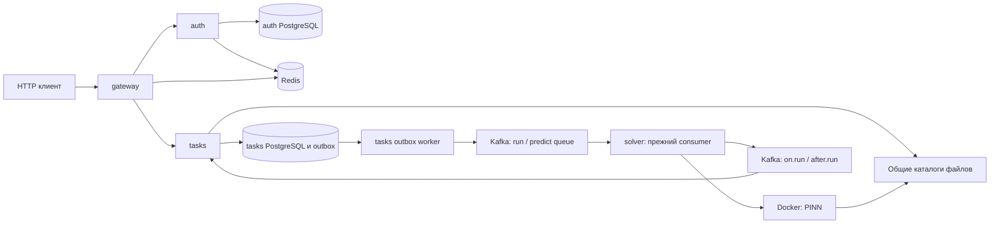

# Архитектура: фактическое состояние

Срез PR #16 на 17 октября 2026 года. Здесь «работает в runtime» означает
подключение в исходном коде, а не подтверждение запуском всего окружения.

## Сервисы и владение данными

В `go.work` пять модулей: общий `pkg` и четыре сервиса. Каждый `cmd/main.go`
собирает зависимости явно. Общий пакет предоставляет технические механизмы;
`internal` сервиса содержит его domain и бизнес-сценарии.

| Часть | Ответственность | Данные и внешние зависимости |
| --- | --- | --- |
| gateway | Проверка access token/сессии, audit context, проксирование HTTP | JWT, Redis через L1 cache, Kafka для compromised session |
| auth | Пользователи, роли, login/refresh/logout | Собственный PostgreSQL, Redis-сессии, consumer compromised session |
| tasks | Загрузка файлов, метаданные, запрос запуска, состояния и выдача результатов | Собственный PostgreSQL, tasks outbox, Kafka, каталоги данных и результатов |
| solver | Выполнение команды train/retrain/predict через Docker | Kafka, Docker API, те же файлы на Docker-host; SQLite пока подготовлена отдельно |
| pkg | HTTP, Kafka, SQL-клиенты, кеш, lifecycle и служебные проверки | Не владеет бизнес-операциями сервисов |

PostgreSQL auth/tasks уже обслуживает их бизнес-данные. SQLite предложена для
локального журнала solver: небольшой объём метаданных и один Docker-host пока
не требуют ещё одного серверного хранилища. Это разные задачи хранения.

## Основной поток

1. `tasks/create` принимает multipart, ограничивает весь body до разбора,
   проверяет набор файлов режима и создаёт задачу с каталогами. Запись файлов
   сейчас выполняется внутри транзакции PostgreSQL — это оставшееся ограничение.
2. `tasks/run` одной транзакцией записывает запрос идемпотентности пользователя,
   блокирует задачу, переводит `created → in_queue` и сохраняет событие outbox.
   Повтор того же ключа и task ID успешен; другой task ID с тем же ключом даёт
   конфликт. Новый ключ не разрешает повторно вычислить уже запущенную задачу.
3. `tasks/internal/outbox` выбирает события с `FOR UPDATE SKIP LOCKED`, публикует
   в Kafka и удаляет подтверждённые записи. Потеря подтверждения/commit допускает
   повтор с тем же ключом. Транзакция остаётся открытой во время Kafka I/O.
4. Solver в `cmd/main.go` использует `StrategyAtMostOnce` и старый `tasks/run`.
   Он публикует `on.run`, вызывает Docker runner и публикует `after.run` напрямую.
   Устойчивая фиксация вычисления и результата в этот маршрут ещё не включена.
5. Consumers tasks применяют события под блокировкой строки. `Task.MarkRunning`
   не возвращает завершённую задачу в running; `Task.Complete` принимает результат
   раньше события старта и сохраняет первый финальный исход.

Идемпотентность HTTP, доставка Kafka и однократность вычисления — три разные
гарантии. Исправление первой не доказывает остальные. `event_id` в принятом
запросе хранит стабильную идентичность команды после удаления outbox; это не FK
на временную очередь.

## Подготовлено для solver, но не подключено

| Механизм | Код | Что ещё нужно |
| --- | --- | --- |
| Файловая SQLite, WAL/FULL, один владелец | `pkg/sqlite` | Runtime-конфигурация, открытие и закрытие журнала |
| Попытки и атомарное завершение с outbox | `solver/internal/adapter/sqlite` | Recovery, взаимодействие с Docker |
| Устойчивый приём команды | `solver/internal/usecases/v1/tasks/accept` | Подключение после готовности восстановления |
| Публикация сохранённых результатов | `solver/internal/usecases/v1/outbox`, `solver/internal/outbox` | Подключение worker под lifecycle |
| Детерминированное имя по run ID | `mlrunner.Config.ContainerName` | Использование новым Docker-адаптером; старый runner имеет прежнее имя |

`AttemptAccepted`, `AttemptContainerCreated`, `AttemptStartRequested`,
`AttemptRunning`, `AttemptFinished` описывают стадии попытки исполнения.
Они не расширяют публичные статусы Task. Для `AttemptRunning` пока нет полного
runtime-перехода. Перед Start нужен сохранённый intent, а неоднозначный ответ
Docker требует Inspect, иначе повторный Start может повторить вычисление.

Общий SQLite-клиент принимает Squirrel-compatible `Sqlizer`, сканирует структуры
через существующий scany/sqlscan и привязывает транзакцию к конкретному клиенту
в контексте. Транзакции разных клиентов независимы: общей атомарности между
двумя файлами нет. Вложенная транзакция того же клиента отклоняется.

`Attempt` создаётся через `NewAttempt`, восстанавливается через `RestoreAttempt`
из непроверенного `AttemptSnapshot`. `RecordContainer`, `RequestStart` и `Finish`
проверяют переход до замены состояния. Репозиторий сохраняет результат метода
условным SQL UPDATE; commit failure возвращает ошибку, а не `Changed(true)`.
`Created` отличает новую регистрацию от успешного повтора. На первом запросе
используется INSERT RETURNING; повтор требует прочитать сохранённую команду и
сравнить параметры в той же транзакции. Unique violation сам по себе не различает
корректный повтор и конфликт параметров.

SQL-строки и Input не являются доменными сущностями. `eventRow/messageRow` отвечают
за преобразование в проверяемые `Event` и `core.KafkaMessage`. Последний владеет
правилами Kafka metadata и `IdKey`/`WithIdKey`; domain проверяет связь ID события
с идентичностью сообщения. `limit.Limit` хранит положительный SQL limit за закрытым
полем. Для нулевого значения Go нужна защита на границе клиента.

Solver outbox отправляет порцию сообщений одним вызовом. Kafka-адаптер переводит
`kafka-go.WriteErrors` в ошибку с подтверждёнными позициями. Usecase удаляет одной
операцией только подтверждённые ID. Неизвестная ошибка оставляет batch для повтора;
неверные индексы внутреннего `core.PartialErr` означают ошибку программирования
и приводят к panic. Driver types в бизнес-логику не проходят.

Готовая сущность повторно не валидируется при передаче между слоями.
`RegisterAttempt` спрашивает `CanRegister`, не повторяет общий Validate.
`WithIdKey` принимает готовые message/key и возвращает только сообщение.
Схема и поля row описаны в `schema.go`, конструкторы row и преобразования —
в `converters.go`. Ошибка конструктора восстановления внутри toDomain означает
нарушение persistence-контракта и вызывает panic; штатные SQL I/O ошибки остаются
ошибками репозитория. Общие `Created`, `Changed`, `PartialErr` находятся в core,
формирование SQL RETURNING — в shared SQLite.

## Развёртывание и границы доверия

Compose связывает tasks с каталогами host и даёт solver доступ к Docker socket.
Дочерний PINN-контейнер получает bind mounts этих каталогов. Поэтому текущее
размещение предполагает общий Docker-host и доступный локальный диск. Перенос
solver на другую машину требует решения доставки файлов, а не только другого
адреса Kafka. Несколько владельцев одного SQLite-журнала запрещены ownership lock.

Новые миграции выполняются внешним Goose через Compose/make, только Up.
Solver доставляет SQL отдельными файлами; конструктор проверяет историю и pending
миграции, ничего не применяет. CLI и клиент используют общий sidecar lock.
Подробности и ограничения backup — в README SQLite-адаптера.

Gateway очищает `X-Internal-*` и добавляет доверенный auth/audit context при proxy.
Внутренние HTTP-сервисы доверяют этим заголовкам. Ограничение прямого доступа к
ним и доступ к Docker socket должны обеспечиваться окружением; наличие middleware
само по себе не устанавливает сетевую границу безопасности.

## Что удачно и что требует внимания

| Решение | Польза | Цена / предел гарантии |
| --- | --- | --- |
| Узкие usecase-ы с Input/Output | Сценарий и зависимости читаются локально, удобно проверять бизнес-поведение | Нельзя прятать SQL/Docker в domain ради сокращения файлов |
| Конкретные имена DI | Видна реальная зависимость и её ограничения | Интерфейс остаётся узким; похожие методы разных БД не обещают одинаковую семантику |
| Транзакционные outbox и условные переходы tasks | Нет окна между commit состояния и созданием события; повтор не портит финал | Доставка может повторяться; старый solver всё ещё допускает потерю команды |
| SQLite у одного владельца | Не нужен новый сервер; локальные попытка/outbox атомарны | Нет failover на другой host, сохранность требует живого диска/volume |
| Lifecycle ждёт workers перед закрытием адаптеров | Ошибка критического consumer останавливает сервис; закрытие не гоняется с worker | Отмена workers сейчас общая, отдельного порядка drain ещё нет; зависимость должна соблюдать context |
| Реальные SQL-тесты и краткий runner | Проверяется больше, чем вызовы mock; успешные тесты не засоряют контекст | Без БД интеграции skipped; линтер не проверяет crash recovery Docker/Kafka |

Главный недостаток сейчас — незавершённость сквозного устойчивого исполнения,
а не недостаток новых абстракций. Следующие изменения должны закрывать конкретные
окна сбоя, сохраняя понятные границы существующих usecase-ов.
